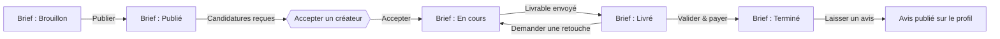

# UGCLink — Design System & Pages

Spécification produit + direction visuelle retenue, pour passation à un·e designer
graphique (maquettes haute-fidélité) et au développement. La structure fonctionnelle
(pages, contenus, actions, parcours) est figée ; l'habillage visuel ci-dessous est la
direction choisie à appliquer.

## Sommaire

1. [Système de design](#01--système-de-design)
2. [Parcours utilisateur](#02--le-parcours-de-bout-en-bout)
3. [Rôles & navigation](#03--rôles--navigation)
4. [Inventaire des pages](#04--inventaire-complet-des-pages)

---

## 01 — Système de design

### Palette

| Rôle | Nom | Hex | Usage |
|---|---|---|---|
| Marque primaire | Baby Pink | `#FBCFE8` | Actions principales, états actifs, mises en avant |
| Accent / hover | Soft Rose | `#F472B6` | Survol de boutons, emphase |
| Fond principal | Pure White | `#FFFFFF` | Zones de contenu, cartes |
| Fond app | Off-White / Light Gray | `#F8FAFC` | Fond général de l'app, sidebar — fait ressortir les cartes blanches |
| Texte principal | Deep Slate | `#334155` | Texte lisible, contraste professionnel sur rose et blanc |
| Texte secondaire | Cool Gray | `#64748B` | Horodatages, libellés secondaires, onglets inactifs |

### Typographie

- **Titres :** Plus Jakarta Sans — propre, arrondie, moderne
- **Texte courant :** DM Sans — très lisible, ton B2B chaleureux

### Composants

- Cartes blanches, grand rayon de bordure (`rounded-2xl`)
- Boutons en forme de pilule (`rounded-full`)
- Ombres douces et diffuses
- Champs de saisie : bordure inférieure uniquement (style login/register)
- Badges de statut : fonds pastel doux (ex. rose clair = brouillon, vert clair = livré)
- Tag/pill secteur : fond rose pâle, texte Deep Slate
- Bouton fantôme (ghost) pour les actions secondaires (ex. « Enregistrer en brouillon », « Demander une retouche »)

---

## 02 — Le parcours, de bout en bout

Un brief traverse cinq états ; c'est la colonne vertébrale de toute l'app — chaque page
existe pour faire avancer ou refléter cette machine à états.

- **L'entreprise** publie un brief (ou l'enregistre en brouillon), reçoit des candidatures,
  et en accepte une — les autres candidatures en attente sont automatiquement refusées.
- Les deux parties atterrissent dans un **espace projet partagé** : messagerie + suivi du
  statut.
- **Le créateur** y dépose son livrable (versionné : v1, v2…).
- L'entreprise **valide et paie** (une commission plateforme est prélevée) ou **demande une
  retouche**, ce qui relance un nouveau cycle de livraison.
- Une fois payé, l'entreprise laisse une **note + avis**, qui met à jour la réputation
  publique du créateur.

---

## 03 — Rôles & navigation

Trois rôles, chacun avec son propre menu latéral persistant : fond Off-White (`#F8FAFC`),
texte Deep Slate. L'état actif se distingue par une pastille de fond Baby Pink et une
icône Soft Rose.

### Entreprise

Dashboard · Briefs · Créateurs · Projets · Messages · Paiements · Paramètres

### Créateur

Dashboard · Briefs disponibles · Mes candidatures · Mes projets · Messages · Mon
portfolio · Paramètres

### Admin

Dashboard (back-office, à construire — écran d'attente pour l'instant)

---

## 04 — Inventaire complet des pages

22 écrans applicatifs + 1 espace partagé. Chaque entrée liste le contenu/les actions
(figés) puis la direction visuelle retenue.

### Public / authentification

#### `/` — Accueil

*Contenu :* logo, accroche en une phrase, boutons « Se connecter » / « Créer un compte ».
Utilisateur déjà connecté → redirection silencieuse vers son tableau de bord.

*Visuel :* écran scindé en deux. À gauche, fond blanc pur avec le wordmark UGCLink, un
titre en Plus Jakarta Sans en gras, et des boutons pilule Baby Pink pour « Se connecter »
et « Créer un compte ». À droite, un graphisme 3D abstrait et fluide (vagues) en dégradés
baby pink / blanc.

#### `/login` — Connexion

*Contenu :* champs email / mot de passe, erreur inline, lien vers l'inscription.

*Visuel :* carte blanche centrée (`rounded-2xl`, ombre douce) sur fond Off-White. Champs
avec bordure inférieure uniquement. Bouton « Se connecter » pleine largeur, Baby Pink.

#### `/register` — Inscription

*Contenu :* choix du rôle, email, mot de passe (8 caractères min.), champs entreprise si
applicable.

*Visuel :* même carte blanche centrée. Sélecteur de rôle visuel à deux grandes tuiles
cliquables (« Entreprise » / « Créateur ») ; la tuile sélectionnée prend une bordure Baby
Pink et un léger fond rose teinté.

### Espace Entreprise

#### `/company` — Dashboard

*Contenu :* salutation + nom entreprise, CTA « Parcourir les créateurs » / « Publier un
brief », 4 KPI (Publiés/En cours/Livrés/Terminés), 5 briefs récents + « Voir tout ».

*Visuel :* « Bonjour, [Nom] » en grand texte, deux CTA Baby Pink. Grille de 4 cartes
blanches identiques pour les KPI, valeurs numériques en grand, Deep Slate. Liste récente
dans un conteneur blanc arrondi.

#### `/company/briefs` — Tous les briefs

*Contenu :* filtrage par statut, une ligne par brief.

*Visuel :* rangée horizontale d'onglets pilule (Tous, Brouillons, Publiés…) ; onglet actif
Baby Pink, inactifs transparents avec texte gris. Lignes pleine largeur, fond blanc, état
au survol. Badges de statut en fonds pastel doux (ex. rose clair = Brouillon, vert clair =
Livré).

#### `/company/briefs/new` — Créer un brief

*Contenu :* titre, secteur, format (6 options), budget (DA), nb créateurs, deadline,
description, « Enregistrer en brouillon » / « Publier le brief ».

*Visuel :* grille de 6 cartes visuelles pour le format ; la carte sélectionnée a une
bordure Baby Pink marquée + icône de coche. Champs de saisie sobres. Barre d'actions
collante en bas : bouton fantôme « Enregistrer en brouillon », bouton plein Baby Pink
« Publier le brief ».

#### `/company/briefs/[id]` — Détail d'un brief + candidatures

*Contenu :* titre/statut/tags, créateur assigné (si accepté), liste des candidatures
avec action « Accepter ».

*Visuel :* en-tête avec tags (secteur, format, budget) et badge de statut. Candidatures en
feed vertical de cartes créateur : avatar, note, extrait du message, bouton plein
« Accepter ».

#### `/company/marketplace` — Créateurs

*Contenu :* recherche + filtres (secteur, note, tri), grille de cartes créateur.

*Visuel :* barre de recherche/filtres collante en haut (dropdowns secteur/note + tri).
Grille 3-4 colonnes ; chaque carte a un bandeau rose pâle en haut, avatar chevauchant le
bandeau, nom, note, bouton « Voir le profil ».

#### `/company/creators/[id]` — Profil public d'un créateur

*Contenu :* identité, portfolio, avis reçus, CTA « Envoyer un brief ».

*Visuel :* colonne gauche (~30%) collante : avatar, bio, tags secteur en pilules roses,
CTA « Envoyer un brief » proéminent. Colonne droite (~70%) : grille de portfolio (liens
externes), puis liste des avis/notes des projets passés.

#### `/company/projects` — Projets

*Contenu :* briefs assignés, statut, bouton « Ouvrir ».

*Visuel :* liste simple, très scannable.

#### `/company/payments` — Paiements

*Contenu :* 3 KPI (nb paiements, total versé, commission totale), liste des paiements.

*Visuel :* 3 cartes KPI en haut, puis tableau de données avec lignes alternées
blanc/off-white.

#### `/company/messages` — Messages

*Contenu :* une conversation par projet actif.

*Visuel :* vue boîte de réception classique : liste des conversations à gauche, panneau
de chat à droite. Bulles : gris pour reçu, Baby Pink pour envoyé.

#### `/company/settings` — Paramètres

*Contenu :* nom entreprise, secteur, email, rôle (lecture seule).

*Visuel :* formulaire mono-colonne, lecture seule.

### Espace Créateur

#### `/creator` — Dashboard

*Contenu :* salutation, CTA « Voir les briefs disponibles », 3 KPI, aperçu projets actifs.

*Visuel :* mêmes cartes blanches KPI que côté entreprise (3 au lieu de 4). Liste d'accès
rapide aux collaborations en cours.

#### `/creator/briefs` — Briefs disponibles

*Contenu :* fil filtrable (secteur, format, budget, tri), CTA « Postuler ».

*Visuel :* feed vertical de cartes horizontales larges, blanches. Logo entreprise, titre,
tags secteur en pilules grises, budget en gras Deep Slate, bouton plein Baby Pink
« Postuler ».

#### `/creator/briefs/[id]` — Détail d'un brief + candidature

*Contenu :* détail complet, formulaire de candidature ou statut existant.

*Visuel :* vue de lecture plein écran du brief. Zone d'action proéminente (bas de page ou
colonne collante à droite) avec zone de texte pour le message optionnel et bouton
« Soumettre la candidature ».

#### `/creator/applications` — Mes candidatures

*Contenu :* historique des candidatures envoyées.

*Visuel :* liste d'historique, badge de statut par ligne.

#### `/creator/projects` — Mes projets

*Contenu :* briefs acceptés, bouton « Ouvrir ».

*Visuel :* liste identique en style à Projets côté entreprise, route vers l'espace projet
partagé.

#### `/creator/messages` — Messages

*Visuel :* layout identique à la boîte de réception entreprise.

#### `/creator/profile` — Mon portfolio

*Contenu :* bio, secteurs (multi-sélection), liens de portfolio.

*Visuel :* formulaire éditable : zone de texte bio, champ tag multi-sélection pour les
secteurs (ajoute des pilules roses), lignes de saisie dynamiques pour ajouter plusieurs
URLs de portfolio.

#### `/creator/settings` — Paramètres

*Contenu :* email, rôle, secteurs, note moyenne (lecture seule).

### Espace partagé

#### `/project/[briefId]` — Espace projet — la page la plus critique

*Contenu :* messagerie, livrables versionnés, suivi de statut, actions de
validation/retouche, avis final.

*Visuel :* interface deux colonnes, 50/50.

- **Colonne gauche — Chat :** messagerie temps réel. Bulles grises pour l'autre partie,
  bulles Baby Pink pour l'utilisateur courant. Champ de saisie en bas.
- **Colonne droite — Livrables & timeline :**
  - En haut : timeline verticale à 5 étapes (Brief validé → Créateur assigné → Contenu en
    production → Livraison → Paiement). Étapes actives en Baby Pink, en attente en gris.
  - En bas : zone de versioning des fichiers (v1, v2…), zone de dépôt par glisser-déposer
    pour le créateur, et boutons d'action pour l'entreprise — « Demander une retouche »
    (style fantôme) et « Valider & payer » (plein Baby Pink).

### Admin

#### `/admin` — Back-office

*Contenu :* écran d'état vide, aucun outil de modération encore construit.

*Visuel :* état vide propre et centré, illustration fluide (vagues « F ») en tons roses et
gris doux, avec texte indiquant que le tableau de bord est en construction.
